# bordermagick

Frame your photos with a border, a title and the camera info read from the photo's EXIF data — from plain white to marble, frosted glass and an Instax-style contact sheet.

Built on [ImageMagick](https://imagemagick.org), which draws every frame, texture and letter, and [ExifTool](https://exiftool.org) by Phil Harvey, which reads the camera, lens and film-simulation data. bordermagick is a shell script on top of these two.

<p align="center">
  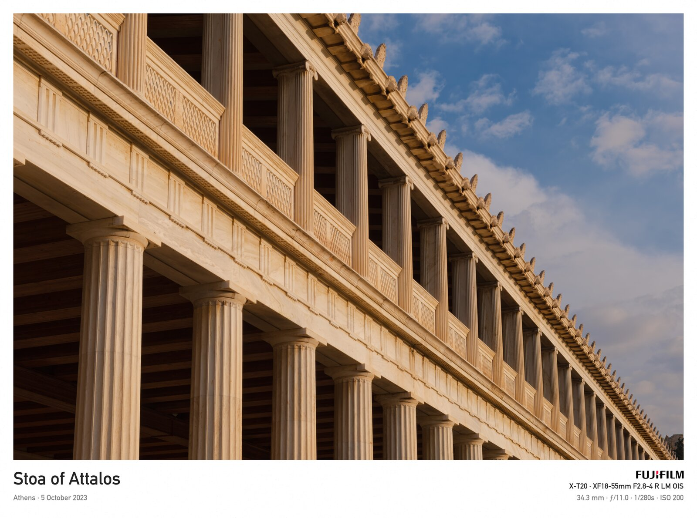
  <br><code>-b white</code>
</p>

<p align="center">
  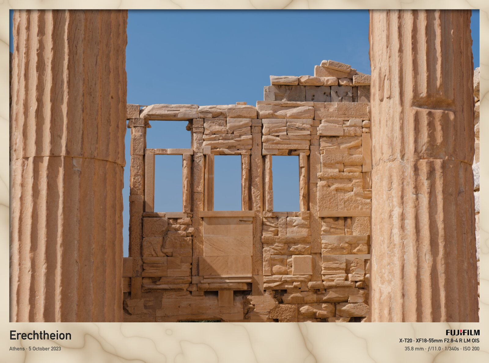
  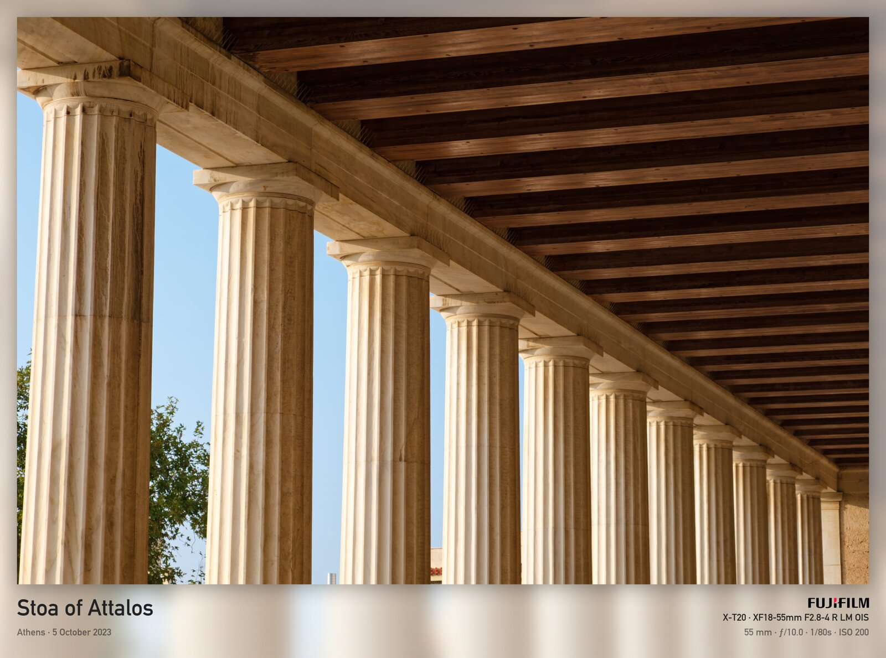
  <br><code>-b marble-beige</code> · <code>-b frost</code>
</p>

<p align="center">
  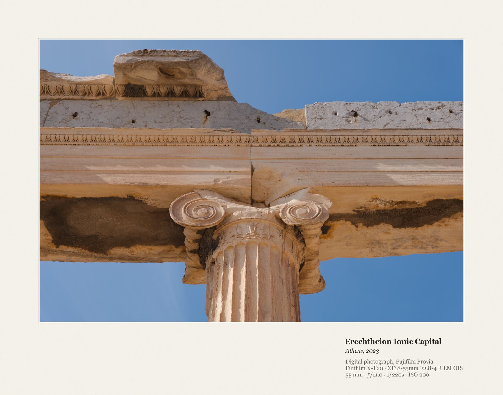
  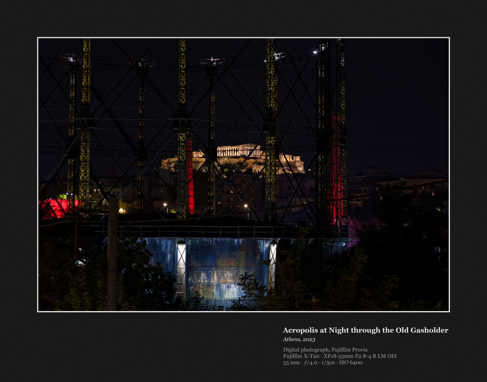
  <br><code>-b museum</code> · <code>-b museum-black</code>
</p>

<p align="center">
  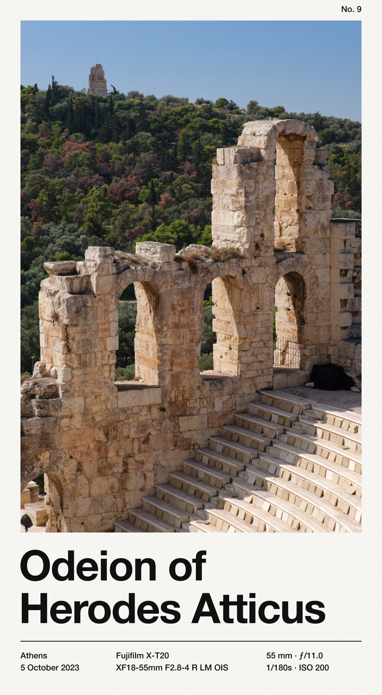
  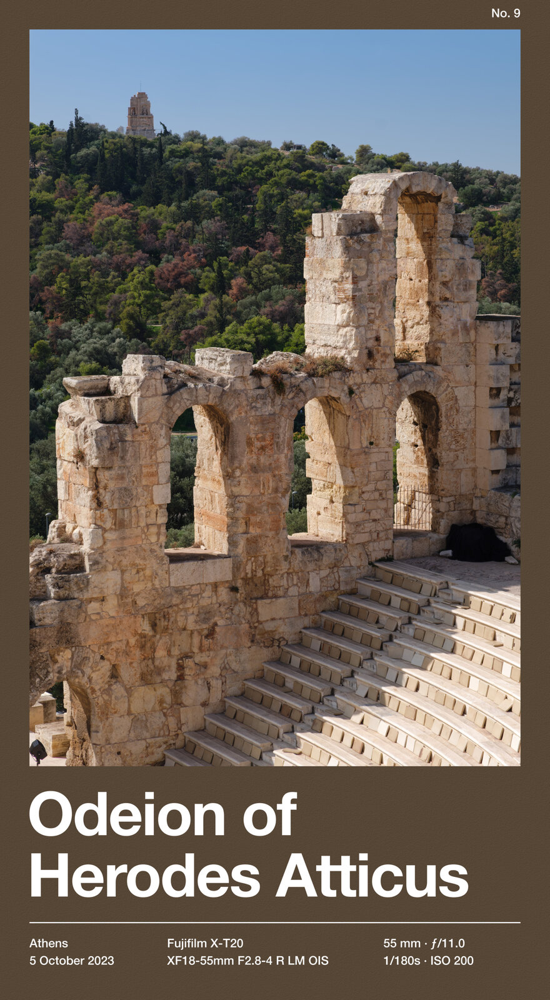
  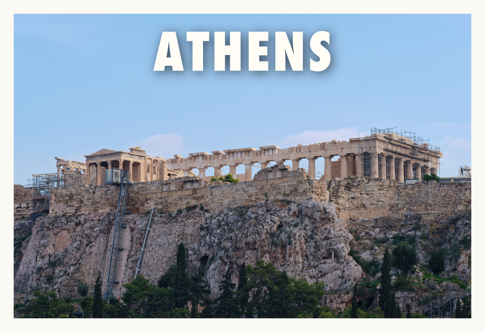
  <br><code>-b poster</code> · <code>-b poster-colour</code> · <code>-b postcard</code>
</p>

<p align="center">
  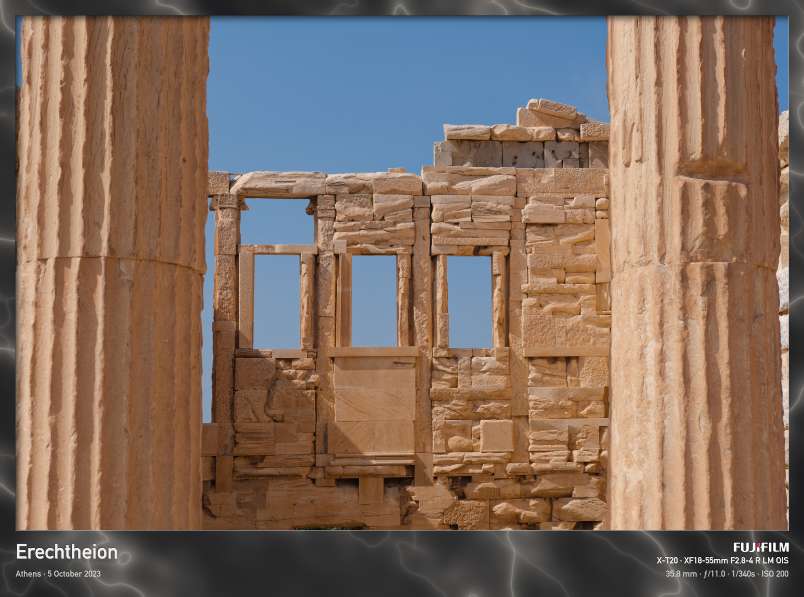
  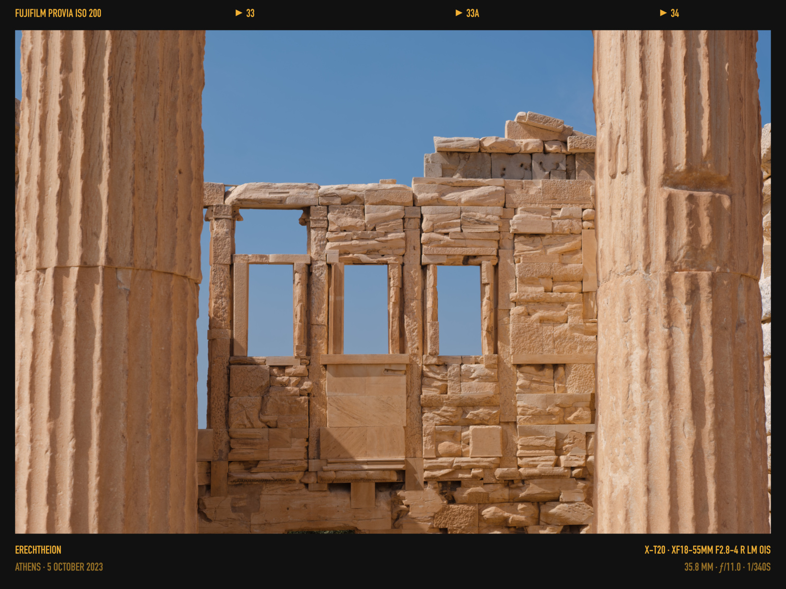
  <br><code>-b marble-dark</code> · <code>-b contact</code>
</p>

<p align="center">
  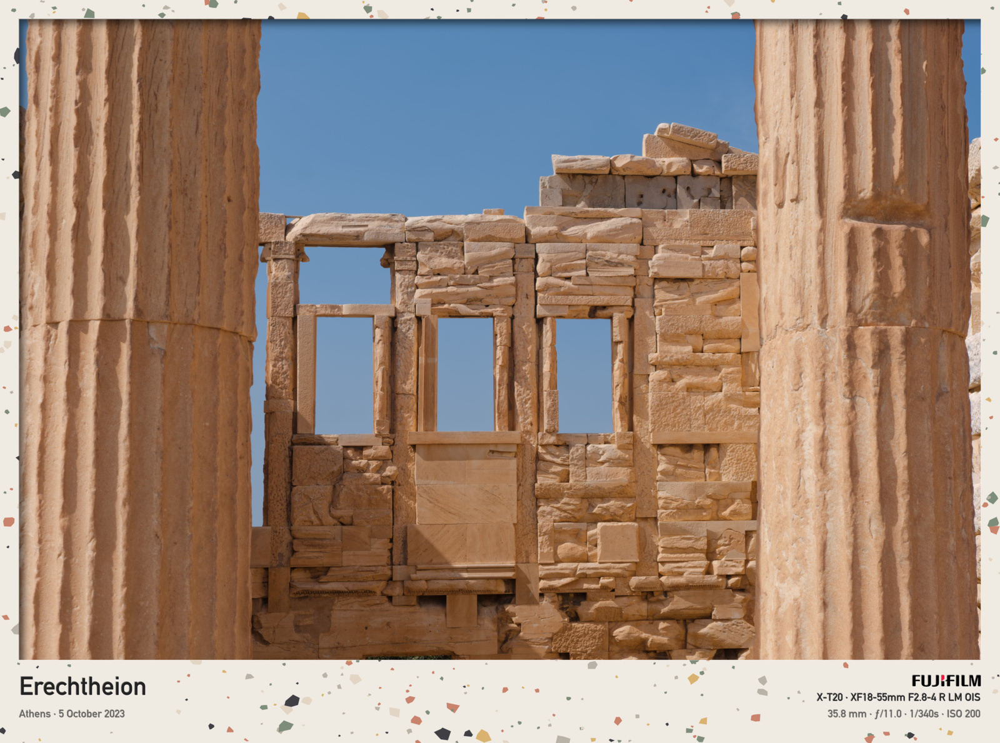
  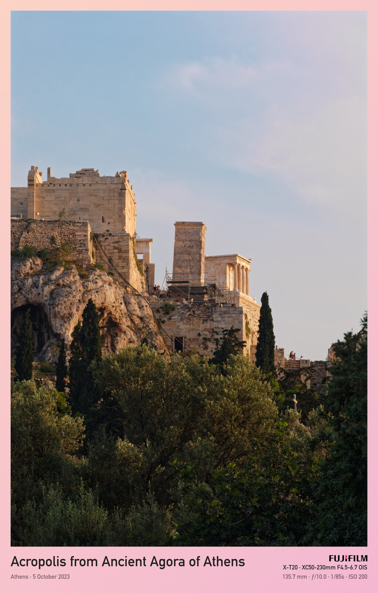
  <br><code>-b terrazzo</code> · <code>-b sunset</code>
</p>

## What it does

- **Title** from the photo's Title tag, else its city, else the file name, with place and date underneath.
- **Camera, lens and exposure** (`X-T20 ∙ XF18-55mm F2.8-4 R LM OIS`, `35.8 mm ∙ ƒ/11.0 ∙ 1/340s ∙ ISO 200`). Lens names come from exiftool's lens database.
- **Maker logo**, downloaded once from Wikimedia Commons and kept for offline use (19 brands, or add your own PNG).
- **Border styles:** solid colours and pastels, gradients, frosted glass, marble (white, dark, green, beige), terrazzo, linen, a museum mount with a gallery wall label (warm off-white, white or black mat), a Swiss-style poster (off-white or in the photo's own colour), a retro travel postcard, two text-free magazine-cover frames, and a film contact sheet showing the Fujifilm film simulation (`FUJIFILM PROVIA ISO 200 ▶ 33 ▶ 33A ▶ 34`).
- **Sizes:** full resolution, keep the original's long edge, or 4K / 2K / Full HD.
- Everything is generated locally; the photo never leaves your machine.

## Install

macOS only for now (it uses fonts that ship with macOS).

```bash
brew install imagemagick exiftool
git clone https://github.com/akostm/bordermagick.git
cd bordermagick
./bordermagick -h
```

Optionally put it on your `PATH`, e.g. `ln -s "$PWD/bordermagick" /usr/local/bin/bordermagick`.

## Usage

```bash
./bordermagick photo.jpg                       # white border, full size
./bordermagick -b marble -s 4k holiday/*.jpg   # marble, long side 3840 px
./bordermagick -b contact photo.jpg            # film contact sheet
./bordermagick -b '#FFD6E0-#B5E2FA' -p 0 photo.jpg   # custom gradient, no paper texture
./bordermagick -m strip -s fhd photo.jpg       # remove all metadata from the result
./bordermagick -L                              # download all known logos now
```

Each photo is written next to the original as `<photo>_<border>_<size>.jpg`, e.g. `IMG_0042_marble_4k.jpg`. Run `./bordermagick -h` for every option and border style.

| Option | Values |
|---|---|
| `-b` border | `white` (default), `black`, `cream`, `pink`, `mint`, `sky`, `lemon`, `lilac`, any colour; `auto`; `sunset`, `ocean`, `aurora`, `peach`, `dusk` or two colours `'#A-#B'`; `frost`, `frost-dark`; `marble`, `marble-dark`, `marble-green`, `marble-beige`, `terrazzo`; `linen`; `contact`; `museum`, `museum-white`, `museum-black`; `poster`, `poster-colour`, `postcard`, `cover-yellow`, `cover-red` |
| `-p` paper texture | `0`–`30`, default `6` (solid and gradient borders) |
| `-s` size | `grow` (default), `fit`, `4k`, `2k`, `fhd`, or a long-side pixel count |
| `-m` metadata | `keep` (default) or `strip` |

## Logos

Logos are stored in `~/.bordermagick/logos/` (set `BORDERMAGICK_HOME` to move it). Known makers are fetched from Wikimedia Commons on first use: Apple (plus iPhone and iPad), Canon, Fujifilm, Google, Hasselblad, Kodak, Leica, Nikon, Olympus, OM System, Panasonic, Pentax, Polaroid, Ricoh, Samsung, Sony and Xiaomi.

For any other maker, drop a transparent PNG into that folder named after the first word of the photo's EXIF Make, in lower case (`SIGMA` → `sigma.png`). Your own files always take priority.

Brand names and logos are trademarks of their respective owners and are used only to identify the camera that took the photo.

## Finder integration (Quick Action)

With a Shortcut you can select photos in Finder, right-click → **Quick Actions → Frame with bordermagick**, pick a style, and get the framed copies next to the originals.

### 1. Allow scripts (once)
Open **Shortcuts → Settings… → Advanced** and turn on **Allow Running Scripts**.

### 2. Create the shortcut
1. **File → New Shortcut** and name it *Frame with bordermagick*.
2. In the **ⓘ Shortcut Details** panel turn on **Use as Quick Action**, tick **Finder** (optionally **Services Menu**), and optionally add a keyboard shortcut.
3. In the **Receive … input from Quick Actions** block at the top, set the input types to **Images** and **Files**, and *If there's no input* to **Stop and Respond**.

### 3. Add these actions, in order

**Pick a style in two steps (category, then style):**

1. **Dictionary** — one key per category, the value a text with the styles separated by `, `:

   | Key | Value |
   |---|---|
   | `Solid` | `white, black, cream, pink, mint, sky, lemon, lilac` |
   | `Auto` | `auto` |
   | `Gradient` | `sunset, ocean, aurora, peach, dusk` |
   | `Glass` | `frost, frost-dark` |
   | `Stone` | `marble, marble-beige, marble-dark, marble-green, terrazzo` |
   | `Fabric` | `linen` |
   | `Gallery` | `museum, museum-white, museum-black` |
   | `Print` | `poster, poster-colour, postcard, cover-yellow, cover-red` |
   | `Darkroom` | `contact` |

2. **Set Variable** `Styles` to *Dictionary*.
3. **List** with the categories in the order you want them shown: `Solid`, `Auto`, `Gradient`, `Glass`, `Stone`, `Fabric`, `Gallery`, `Print`, `Darkroom`, `Custom…`
4. **Choose from List** — prompt `Border style`.
5. **If** *Selected Item* **is** `Custom…`
   - **Ask for Input** — Text, prompt `Colour or gradient, e.g. #2B4C7E or #FFD6E0-#B5E2FA`
   - **Set Variable** `Border` to *Provided Input*

   **Otherwise**
   - **Get Dictionary Value** — *Value* for key *Selected Item* in *Styles*
   - **Split Text** — *Dictionary Value* by **Custom** `, ` (comma and space)
   - **Choose from List** — prompt `Border`
   - **Set Variable** `Border` to *Selected Item*

   **End If**

   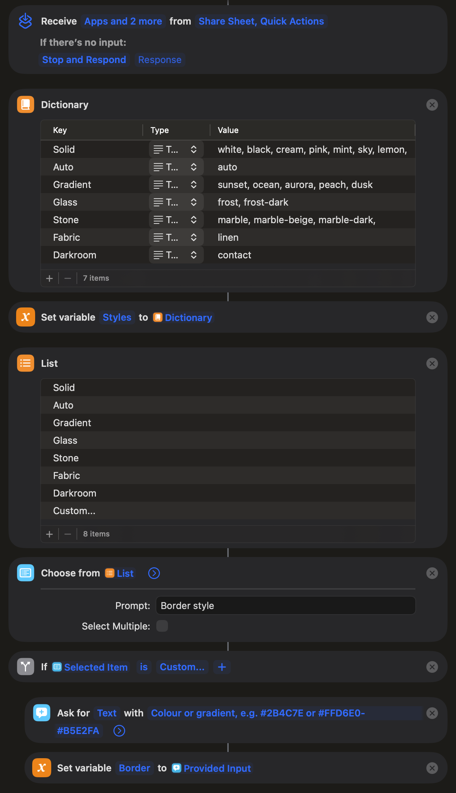

**Size and metadata:**

6. **List** `grow`, `fit`, `4k`, `2k`, `fhd` → **Choose from List** (prompt `Size`) → **Set Variable** `Size`.
7. **List** `keep`, `strip` → **Choose from List** (prompt `Metadata`) → **Set Variable** `Meta`.

   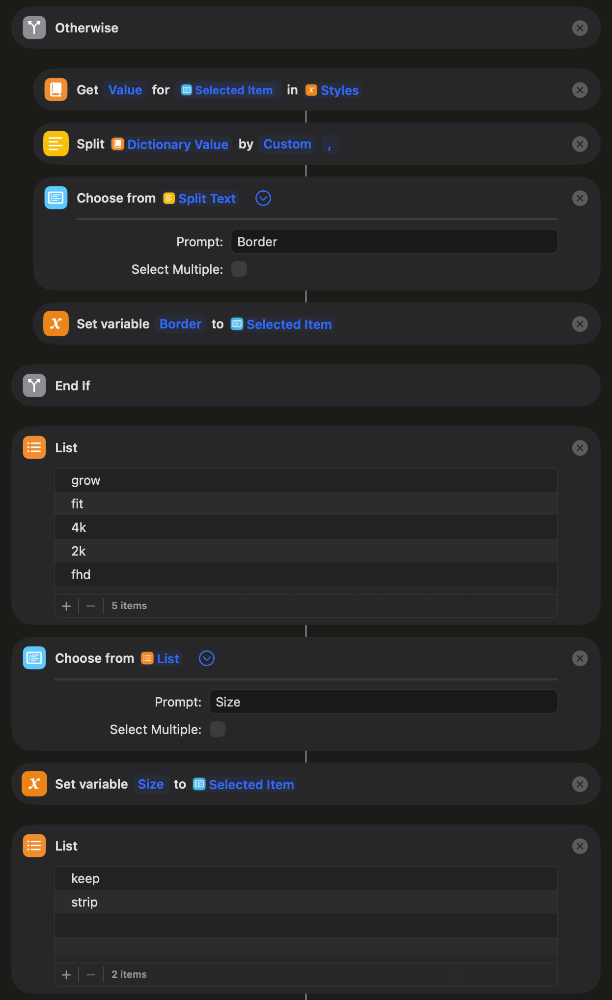

**Run it:**

8. **Run Shell Script**
   - Shell: `bash`, Input: **Shortcut Input**, Pass Input: **as arguments**
   - Script (use the full path to where you put `bordermagick`):
     ```bash
     /path/to/bordermagick -b "Border" -s "Size" -m "Meta" "$@" 2>&1
     ```
     Replace the words `Border`, `Size` and `Meta` inside the quotes with the variables of the same name: delete the word, right-click there → **Insert Variable**. Keep the quotes and `"$@"` so file names with spaces work.
9. **Show Notification** — title `bordermagick`, text *Shell Script Result*.

   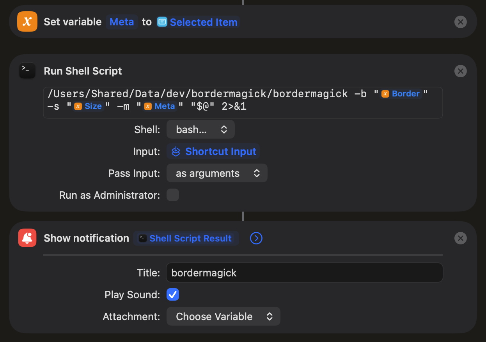

Variables like *Selected Item* or *Dictionary Value* are inserted as variable tokens, not typed.

### 4. Use it
Select photos in Finder → right-click → **Quick Actions → Frame with bordermagick**. The first time, macOS asks whether Shortcuts may access the folder — choose **Always Allow**. If something goes wrong (e.g. an unknown colour), Shortcuts shows bordermagick's error message instead of the notification.

Tips:
- To skip the metadata question, leave out step 7 and write `-m keep` or `-m strip` directly in the script; or make two shortcuts.

## Development

`tests/render.sh` frames a few generated test photos in every style and option, with the random textures fixed (`BORDERMAGICK_SEED`), so changes can be checked pixel for pixel:

```bash
tests/render.sh baseline     # before a change: save reference renders
tests/render.sh compare      # after it: everything identical? differences are listed, with diff images
```

Real photos can be added as arguments. Renders go to `tests/out/` (not committed).

`tests/unit.sh` runs the quick checks of the code in `lib/` (no renders):

```bash
tests/unit.sh
```

The script loads its helpers from `lib/`, so keep that folder next to `bordermagick` (a symlink to the script is fine).

## License

[MIT](LICENSE)
